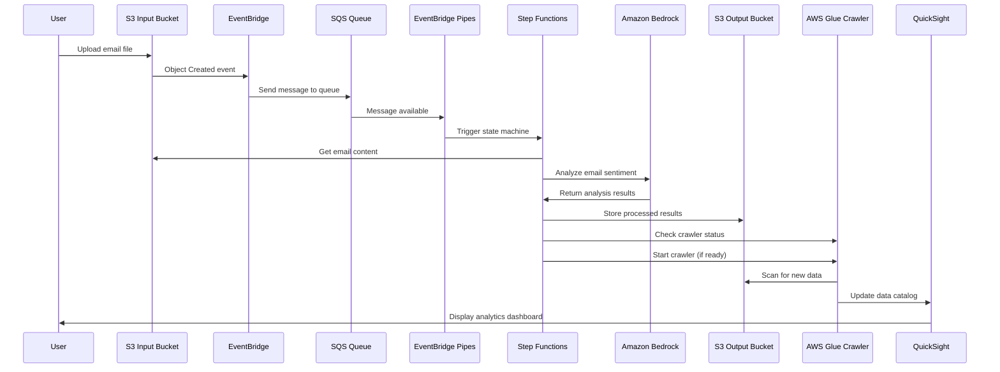

<!--
Copyright Amazon.com, Inc. or its affiliates. All Rights Reserved.
SPDX-License-Identifier: MIT-0
-->

## Automated Email Classification with Amazon Bedrock

## Security

See [CONTRIBUTING](CONTRIBUTING.md#security-issue-notifications) for more information.

## License

This library is licensed under the MIT-0 License. See the LICENSE file.

## Overview

This project demonstrates a proof of concept workflow for automating email sentiment anaylsis using a large language model.

## Architecture Overview

The Automated Classification system processes uploaded emails through an automated workflow that analyzes sentiment and categorizes emails for triage. The architecture leverages serverless AWS services to create a scalable, event-driven pipeline.


### Detailed Workflow



### Service Details

- **S3 Input Bucket**: Stores uploaded email files with EventBridge notifications enabled
- **EventBridge**: Captures S3 object creation events and routes to SQS
- **SQS Queue**: Provides reliable message queuing with dead letter queue for failed processing
- **EventBridge Pipes**: Connects SQS to Step Functions for event-driven execution
- **Step Functions**: Orchestrates the email processing workflow
- **Amazon Bedrock**: Performs sentiment analysis and email categorization using Nova Pro model
- **S3 Output Bucket**: Stores processed email analysis results in JSON format
- **AWS Glue Crawler**: Automatically discovers and catalogs the output data schema
- **QuickSight**: Provides analytics dashboard for visualizing email triage data

## Prerequisites

Create a dedicated AWS account to host this workload in for isolation.

Amazon QuickSight account should be configured with access to Amazon Athena and Amazon S3, an appropriate user should be created. You will need to pass the user arn to the cdk deploy command.

The QuickSight User ARN can be constructed using: 
https://docs.aws.amazon.com/quicksight/latest/APIReference/qs-resource-arns.html

or discovered using the CLI command:
https://awscli.amazonaws.com/v2/documentation/api/latest/reference/quicksight/list-users.html

You need to have AWS CDK installed and your account bootstrapped.
https://docs.aws.amazon.com/cdk/v2/guide/getting-started.html
https://docs.aws.amazon.com/cdk/v2/guide/bootstrapping-env.html

## Usage Instructions

Install all dependencies used in the project with: `npm install`

### Deployment Parameters

The project provides runtime configuration parameters that can be customized during deployment:

| Parameter | Default Value | Description |
|-----------|---------------|-------------|
| emailBucketName | email-triage-bucket-demo | Name of S3 bucket for uploaded emails |
| emailOutputBucketName | email-output-bucket-demo | Name of S3 bucket for processed emails |
| glueDatabaseName | email_triage_db_demo | AWS Glue Database Name |
| glueCrawlerName | email-triage-crawler-demo | AWS Glue Crawler Name |
| quicksightDataSetName | email-triage-dataset | QuickSight Dataset Name |
| quicksightUserArn | arn:aws:quicksight:{region}:{account}:user/default/admin | QuickSight User ARN |
| destroyData | false | Whether to destroy S3 data on stack deletion |

### Deployment Command Example

The stack must be deployed with a valid QuickSight user arn and custom S3 bucket names. The destroy data setting can be used for development testing:
```bash
cdk deploy \
  -c quicksightUserArn="arn:aws:quicksight:us-east-1:111122223333:user/default/your-user" \
  -c emailBucketName="amzn-s3-demo-source-bucket" \
  -c emailOutputBucketName="amzn-s3-demo-destination-bucket" \
  -c destroyData=true
```

### Data Considerations

Data passed through the system is logged to CloudWatch, do not use with sensitive data.

**Note**: When `destroyData=true` is set, S3 buckets and their contents will be permanently deleted when the stack is destroyed. Use with caution in production environments.

## Cleanup Instructions

To completely remove all infrastructure created by this stack:

### 1. Delete Glue Database and Tables (Manual)

The AWS Glue crawler creates a database and tables that are not automatically deleted by CDK, they need to be removed manually.

### 2. Empty and Delete S3 Buckets (if destroyData=false)

If you deployed the stack without `destroyData=true`, manually empty the input and output S3 buckets then delete them.

### 3. Destroy the CDK Stack

```bash
cdk destroy
```

## Troubleshooting

### QuickSight DataSource error

If you see an S3 permissions error in the QuickSight DataSource ensure that you have given QuickSight permission to access the output S3 bucket.
https://docs.aws.amazon.com/quicksight/latest/user/troubleshoot-connect-S3.html